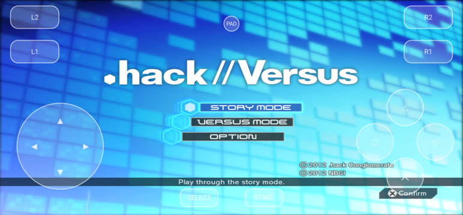

# .hack//Versus — port nativo para Android y Windows

*Español. [English version](README.md).*

> [!IMPORTANT]
> No se incluye ningún archivo del juego. Necesitas tu propia copia legal de **.hack//Versus** (PlayStation 3,
> BLJS93008) como imagen de disco (`.iso`). Es un proyecto de aficionado, sin relación con CyberConnect2, Bandai Namco
> ni Sony.

> [!NOTE]
> Trabajo en curso. Las peleas, los menús, el guardado y el mando funcionan; el Story Mode y los modos online no se
> han recorrido de punta a punta. Informes de fallos y mejoras son bienvenidos: abre un issue o un pull request.

Port **nativo** (sin emulador) del juego de lucha .hack//Versus a **Android ARM64** y **Windows x64**, hecho por
recompilación estática con [ps3recomp](https://github.com/sp00nznet/ps3recomp): el código PPU del juego está traducido
a C++ y compilado para cada plataforma, los programas SPU están traducidos igual y la GPU RSX se emula sobre Vulkan.
No es un emulador. Probado en un Samsung Galaxy S22 Ultra (Snapdragon 8 Gen 1, Adreno 730, Android 16) y en un PC con
Windows 10 (Ryzen 7 5700X3D, GeForce RTX 3050).


## Características

- El juego corre como una app nativa: instala el APK, elige tu ISO y juega. Sin firmware de PS3, sin extraer nada.
- Lee la imagen de disco directamente (lector ISO9660 propio), sin copiarla ni pedir permisos de almacenamiento.
- Mando Bluetooth (DualShock 4 y compatibles) con el mapeo de la PS3, incluidos L3/R3; pad táctil en pantalla
  que se puede ocultar (botón **PAD**).
- Guardado, sonido (música, voces y golpes), intro recortada a los logos, pantalla completa.
- Rendimiento: menús a 30 fps (tope del juego); peleas a 25–27 fps en el teléfono con el ahorro de batería activado
  y 30 fps estables en el PC.
- Windows: pantalla completa a la resolución del escritorio (F11 o Alt+Enter alternan con ventana), mandos por SDL y
  teclado como respaldo.



## Requisitos

**Android**
- Teléfono ARM64 con Vulkan 1.1 y Android 12 o superior; 8 GB de RAM recomendados.
- Unos 4,3 GB libres para la ISO (la app no la copia). El APK ocupa 35 MB.
- Tu imagen de disco de .hack//Versus (ver "Versiones compatibles").

**Windows**
- Windows 10 u 11 de 64 bits, una CPU con AVX2 (Intel Haswell / AMD Zen o posterior) y una GPU con drivers Vulkan 1.1.
- Unos 4,3 GB para el disco extraído más 2 GB para la instalación en el HDD que hace el juego.

## Versiones compatibles

| Disco | Estado |
|---|---|
| BLJS93008 (Japón, el único lanzamiento del juego) con el parche de traducción al inglés aplicado | Es la versión con la que se hizo el port y con la que se ha probado todo |
| BLJS93008 sin parchear | Debería funcionar (el ejecutable que lleva el APK es el del parche; los textos vendrían en japonés), no probado |
| Otras regiones o versiones digitales | No existen para este juego |

El APK incluye el ejecutable del juego ya traducido (lo que en la PS3 era el `EBOOT.BIN`): no hace falta descifrar
nada ni usar un emulador. Si tienes un `EBOOT.ELF` propio, la app lo prefiere si está junto a los datos.

## Cómo jugar (Android)

1. Descarga `hackversus.apk` de **Releases** e instálalo (permite "instalar apps desconocidas" si Android lo pide).
2. Copia tu `.iso` al teléfono, en cualquier carpeta (Descargas, por ejemplo).
3. Abre la app y pulsa **Elegir ISO**: se abre el selector de archivos de Android; marca tu imagen. La app guarda el
   permiso sobre ese archivo y no vuelve a preguntar. La primera vez tarda algo más (instala sus datos y compila
   shaders); después arranca en unos 20 segundos.

Alternativas, si prefieres no usar el selector:
- Deja la ISO en `/sdcard/PS3/` y pulsa **Dar permiso** en el diálogo (abre el interruptor "Acceso a todos los
  archivos" de la app). Es la misma carpeta y el mismo archivo que usa el emulador ARMSX3, por si tienes ambos.
- O extrae el disco en el PC (`python tools/iso_extract.py <tu.iso> all disc`) y copia `disc/PS3_GAME` a
  `/sdcard/PS3/vfs/PS3_GAME` o a `Android/data/com.hackversus.port/files/PS3/vfs/PS3_GAME` (esta última sin permiso).

Dónde deja las cosas la app:
```
Android/data/com.hackversus.port/files/
  PS3/dev_hdd0/home/00000001/savedata/   partidas (modo ISO; con /sdcard/PS3 van en /sdcard/PS3/dev_hdd0/...)
  PS3/hv_env.txt                          opciones (ver abajo)
  EBOOT.ELF, spirv/, pipeline.cache       el ejecutable desempaquetado y las cachés de shaders
  log.txt                                 registro de la sesión (se vacía en cada arranque)
```
Desinstalar la app borra esa carpeta, partidas incluidas: cópialas antes si te importan.

## Cómo jugar (Windows)

1. Descarga `hackversus-windows.zip` de **Releases** y descomprímelo donde quieras: `hackversus.exe`, `SDL2.dll` y
   el ejecutable del juego ya traducido, `EBOOT.ELF`.
2. Extrae tu disco junto a ellos, en una carpeta llamada `disc` (hace falta Python 3):
   `python tools/iso_extract.py <tu.iso> all disc` — queda `disc/PS3_GAME/...`.
3. Abre `hackversus.exe`. La primera vez tarda más (la instalación de ~2 GB en el HDD y las cachés de shaders).

La versión de PC todavía no lee la ISO directamente. Las partidas, la instalación del HDD y las cachés de shaders van
en `data/` junto al ejecutable; las opciones, en `hv_env.txt` junto a él. También se le pueden pasar las rutas:
`hackversus.exe <EBOOT.ELF> <carpeta del disco>`.

## Controles

- **Mando Bluetooth**: empareja un DualShock 4 (o compatible) con Android antes de abrir la app; el port lo asigna al
  puerto 1 con el mapeo de la PS3 (✕○□△, L1/R1/L2/R2, L3/R3, START/SELECT, cruceta y sticks).
- **Pad táctil**: siempre activo como jugador 1; el botón **PAD** (arriba al centro) lo oculta o lo muestra.
- **Windows**: cualquier mando que reconozca SDL (DualShock 4, DualSense, Xbox…). Sin mando, el teclado: flechas =
  cruceta, Z/X/A/S = ✕/○/□/△, Q/W = L1/R1, 1/2 = L2/R2, Enter = START, Tab = SELECT. F11 o Alt+Enter alternan entre
  pantalla completa y ventana; Esc sale de pantalla completa (en ventana cierra el juego).
- Los controles del juego están en el propio juego: en una pelea, START → "Basic Operation", "Command List" y
  "Battle Key Config".

## Opciones (`hv_env.txt`)

Archivo `hv_env.txt` en la carpeta de datos (`Android/data/com.hackversus.port/files/PS3/` en modo ISO, o
`/sdcard/PS3/`; en Windows junto a `hackversus.exe`), una `VARIABLE=valor` por línea:

| Variable | Efecto |
|---|---|
| `PS3_OSK_TEXT=NOMBRE` | Nombre que el port escribe cuando el juego pide texto (Story Mode: máximo 8 caracteres, el juego no deja cambiarlo después). Por defecto `PLAYER`. |
| `HV_KEEP_ASPECT=1` | 16:9 con barras en vez de estirar a toda la pantalla. |
| `HV_INTRO=orig` | Intro completa (por defecto se muestran solo los logos de Bandai Namco y CRIWARE). |
| `HV_JC_PAR=n` | Hilos para los jobs SPU (3 por defecto). |
| `HV_AUDIO_LEGACY_PACE=1` | Mezclador de audio original de ps3recomp (por si el nuevo suena peor en tu equipo). |
| `HV_LOG=0` | Sin registro: no se escribe `log.txt`. |
| `PS3RECOMP_VK_FULLSCREEN=0` | Windows: arrancar en ventana. |

## Problemas conocidos

- Las peleas no llegan a los 30 fps estables con el ahorro de batería activado (los núcleos quedan a 1,2–1,8 GHz);
  sin él sobra margen. El cuello es la CPU (hilo principal, jobs SPU de skinning, comandos RSX), no la GPU.
- El Story Mode pide un nombre de personaje por teclado en pantalla: el port lo rellena solo (`PS3_OSK_TEXT`).
- Sin online, sin trofeos reales, sin música del usuario (todo son stubs).
- Tras una sesión larga el teléfono se calienta y baja de frecuencia: es normal, no es un fallo del port.

## Cómo se construye

Todo el entorno es portátil y vive en la carpeta del proyecto; nada se instala en el sistema.

1. **Toolchain** (no incluido): Android NDK r30, CMake ≥ 3.28, Ninja, JDK 17, build-tools 35.0.1 y `android.jar`
   de API 35, Python 3.10 con `pip install -r ps3recomp-0.18.0/requirements.txt`, y en `sysroot/` SDL2 y glslang
   compilados para `arm64-v8a`.
2. **Lift del juego** (una vez, en el PC; `game/EBOOT.ELF` es el ejecutable descifrado, que un emulador con
   `PPU Debug` vuelca en `cache/ppu_progs/BLJS93008-*/exec.elf`):
   ```
   P=.venv/Scripts/python; R=ps3recomp-0.18.0/tools
   $P $R/ppu_loader.py game/EBOOT.ELF -o analysis/
   $P $R/find_functions.py game/EBOOT.ELF --seed-json analysis/EBOOT.functions.json --output analysis/functions.json
   $P $R/extract_spu_images.py game/EBOOT.ELF --output spu_programs/
   $P $R/ppu_lifter.py game/EBOOT.ELF --functions analysis/functions.json --hle-stubs analysis/EBOOT.imports.json \
       --code-end 0x7bf7b0 --chunks 64 -o recomp/
   ```
   Los jobs SPURS (skinning) no están en el ELF: se vuelcan en el teléfono con `SPU_DUMP_MISS=<dir>` la primera vez
   que el juego los usa y van a `spu_jobs/*.elf`.
3. **APK**: `tools/build_apk.sh` → `out/hackversus.apk` (configura CMake con el NDK, compila el runtime, los 64 archivos
   PPU traducidos y los SPU, enlaza `libmain.so`, mete `game/EBOOT.ELF` como asset, compila la actividad Java y
   firma con una clave de depuración). El código PPU completo recompila en unos 3 minutos con 16 núcleos.

4. **Windows**: con [llvm-mingw](https://github.com/mstorsjo/llvm-mingw) (ucrt, x86_64) descomprimido en `toolchain/`
   (sin Visual Studio), una vez `tools/build_win_deps.sh` (SDL2 y glslang en `sysroot-win/`) y luego
   `tools/build_win.sh` → `out-win/hackversus.exe`. El build de PC apunta a x86-64-v3 (AVX2) y usa el mismo backend
   Vulkan a través de SDL2. `tools/win_fight.sh [VAR=valor ...]` llega a una pelea CPU VS CPU con el teclado y la mide
   (toma la ventana y el teclado durante unos dos minutos).

Los scripts de `tools/` (`goto_fight.sh`, `measure_fight.sh`, `prof_threads_fast.py`, …) sirven para llegar a una
pelea sin tocar el teléfono, medir fps y perfilar; llevan escrito el identificador adb del equipo con que se desarrolló,
cámbialo por el tuyo.

## Qué cambia respecto a ps3recomp 0.18.0

El toolkit va incluido en `ps3recomp-0.18.0/` con las modificaciones de este port (licencia MIT, ver su `LICENSE`).
Entre otras: backend Vulkan para Android (render passes fusionados, lotes de dibujos, present asíncrono, profundidad
leída como color en compute), escalarización de los bancos de registros de los shaders para Adreno, jobs SPURS en
paralelo con hilos, colas de eventos SPU del driver de sonido, VMX y FP escalar en NEON/sin comprobaciones de NaN,
fetch de vértices e índices en NEON, `cellOskDialog` funcional, guardado, pad táctil y mando. Para Windows: el backend
Vulkan compilado con mingw (carga con `LoadLibrary` en vez de `dlopen`), SDL2 para mando y audio, un hilo para los
callbacks de GCM, el teclado como respaldo con cualquier backend de mando y un mezclador de audio que deja a los drivers
de sonido del juego un periodo de bloque entre bloques. El lector de ISO
(`hackversus/isofs.c`) se cuelga debajo de la API de archivos del host con `--wrap` del enlazador, así que ninguna
capa del runtime cambia. Los detalles técnicos están en los comentarios del código.

## Créditos

- CyberConnect2 y Bandai Namco, creadores de .hack//Versus.
- [sp00nznet](https://github.com/sp00nznet/ps3recomp), por ps3recomp.
- El equipo del parche de traducción al inglés de .hack//Versus.
- SDL2, glslang, el NDK de Android y llvm-mingw.

## Licencia

El código de este repositorio es [MIT](LICENSE), como ps3recomp; los componentes de terceros conservan sus licencias.
No concede ningún derecho sobre el juego: .hack//Versus es propiedad de CyberConnect2 y Bandai Namco. Este repositorio
no contiene datos del juego; el APK y el build de Windows contienen el código del juego traducido a ARM64 por la recompilación estática y no
funciona sin una copia legítima del disco. Si los titulares de los derechos lo piden, se retira.
