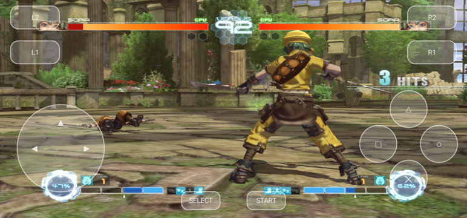

# .hack//Versus — native port for Android and Windows

*English · [Español](README.es.md)*

A **native** port of the PS3 fighting game .hack//Versus to **Android (ARM64)** and **Windows (x64)**. It is not an
emulator: the game's code was translated to C++ by static recompilation with
[ps3recomp](https://github.com/sp00nznet/ps3recomp) and compiled for each platform; the PS3 graphics chip is
reproduced on Vulkan.

> [!IMPORTANT]
> No game files are included. You need your own legally obtained copy of **.hack//Versus** (PS3, BLJS93008) as a
> disc image (`.iso`). A fan project, not affiliated with CyberConnect2, Bandai Namco or Sony.



## Contents

- [Status](#status)
- [Download and play](#download-and-play)
- [Controls](#controls)
- [Options](#options-hv_envtxt)
- [Character mods](#character-mods-experimental)
- [Known issues](#known-issues)
- [Building from source](#building-from-source)
- [Credits and license](#credits-and-license)

## Status

| | Android | Windows |
|---|---|---|
| Fights | Steady 30 fps (the game's cap), battery saver on | Steady 30 fps |
| Menus, saving, sound | Yes | Yes |
| Controllers | Bluetooth (DualShock 4 and compatibles) + on-screen touch pad | Any SDL controller + keyboard |
| Story Mode, online | Not played through / no online | Same |

Tested on a Samsung Galaxy S22 Ultra (Snapdragon 8 Gen 1, Android 16) and a Windows 10 PC (Ryzen 7 5700X3D,
RTX 3050). Bug reports and pull requests are welcome.

## Download and play

Download from **[Releases](../../releases)**.

### Supported disc

| Disc | Status |
|---|---|
| BLJS93008 (Japan, the only release) with the English translation patch | Fully tested |
| BLJS93008 unpatched | Should work (texts in Japanese), untested |

The game's translated executable ships with the port: nothing to decrypt, no PS3 firmware.

### Android

Needs an ARM64 phone with Vulkan 1.1, Android 12+, 8 GB of RAM recommended, and about 2 GB free for the game's
HDD install (the ISO is read in place, not copied).

1. Install `hackversus.apk` (allow "unknown apps" if asked).
2. Copy your `.iso` anywhere on the phone (Downloads, for example).
3. Open the app, tap **Elegir ISO** ("Choose ISO") and select the image. The first start takes a few minutes (the
   game installs ~2 GB to its virtual HDD and shaders compile); afterwards it starts in about 20 seconds.

<details>
<summary>Other ways to give it the game, and where data is kept</summary>

- Put the ISO in `/sdcard/PS3/` and tap **Dar permiso** ("Grant permission") to allow all-files access (same folder
  the ARMSX3 emulator uses).
- Or extract the disc on a PC (`python tools/iso_extract.py <your.iso> all disc`) and copy `disc/PS3_GAME` to
  `Android/data/com.hackversus.port/files/PS3/vfs/PS3_GAME`.

```
Android/data/com.hackversus.port/files/
  PS3/dev_hdd0/game/BLJS93008/           the game's HDD install
  PS3/dev_hdd0/home/00000001/savedata/   saves
  PS3/hv_env.txt                         options
  PS3/hv_mods.txt                        character mods
  log.txt                                session log
```
Uninstalling the app deletes this folder, **saves included**: back them up first.
</details>

### Windows

Needs Windows 10/11 64-bit, a CPU with AVX2 (Intel Haswell / AMD Zen or later) and a Vulkan 1.1 GPU.

1. Unzip `hackversus-windows.zip` anywhere.
2. Run `hackversus.exe` and choose your `.iso` (or drop the ISO onto the exe). It is remembered for next time.

Windows mounts the ISO read-only while the game runs. Saves, caches and `log.txt` go to `data/` next to the exe.

## Controls

| | |
|---|---|
| Controller | PS3 layout: ✕○□△, L1/R1/L2/R2, L3/R3, START/SELECT, d-pad and sticks. On Android pair it before opening the app. |
| Touch pad (Android) | Always active as player 1; the **PAD** button hides it. |
| Keyboard (Windows) | Arrows = d-pad · Z/X/A/S = ✕/○/□/△ · Q/W = L1/R1 · 1/2 = L2/R2 · Enter = START · Tab = SELECT |
| Window (Windows) | F11 or Alt+Enter toggle full screen; Esc leaves full screen. |

The move lists are in the game: during a fight, START → "Command List".

## Options (`hv_env.txt`)

A text file with one `VARIABLE=value` per line, in `files/PS3/` on Android or next to `hackversus.exe` on Windows.

| Variable | Effect |
|---|---|
| `PS3_OSK_TEXT=NAME` | Name typed for you when Story Mode asks (8 characters max). Default `PLAYER`. |
| `HV_KEEP_ASPECT=1` | 16:9 with black bars instead of stretching. |
| `HV_INTRO=orig` | Full intro (by default only the Bandai Namco and CRIWARE logos). `HV_INTRO=0,17` skips the logos too. |
| `HV_PIPE_PREWARM=0` | Do not precreate graphics pipelines at start (on by default; avoids stutters the first time an effect appears). |
| `HV_JC_PAR=n` | Threads for SPU jobs (default 3). |
| `HV_AUDIO_LEGACY_PACE=1` | ps3recomp's original audio mixer. |
| `HV_LOG=0` | Do not write `log.txt`. |
| `PS3RECOMP_VK_FULLSCREEN=0` | Windows: start in a window. |

## Character mods (experimental)

The port can swap a character's model for another one **as an extra colour** in the character select, leaving the
original colours untouched. Mods are listed in `hv_mods.txt` (`files/PS3/` on Android, `data/` on Windows):

```
# subst <model> <colour index> <carousel slot> <offset in DATA.CPK, hex> <length> <file>
subst 1kit01 2 3 BE07800 7393184 mods/my_kite.bin
```

That line adds **colour 3** to Kite (carousel slot 3) and serves `mods/my_kite.bin` instead of the original model data
when that colour is picked. The replacement must be the same size and format as the original entry in `DATA.CPK`.
No mod files are distributed with the port. Available from APK v0.4, and on Windows when built from source.

## Known issues

- Story Mode asks for a name with the on-screen keyboard; the port fills it in (`PS3_OSK_TEXT`) and it cannot be
  changed later.
- No online, trophies or custom music.
- After long sessions the phone heats up and slows down; that is the phone, not the port.

**Roadmap:** online Versus between PC and Android through a replacement lobby server (the original servers are gone).

## Building from source

Everything lives in the project folder; nothing is installed system-wide.

<details>
<summary>Build steps</summary>

1. **Toolchain** (not included): Android NDK r30, CMake ≥ 3.28, Ninja, JDK 17, build-tools 35.0.1 and the API 35
   `android.jar`, Python 3.10 with `pip install -r ps3recomp-0.18.0/requirements.txt`, and SDL2 + glslang for
   `arm64-v8a` in `sysroot/`.
2. **Lift the game** once (`game/EBOOT.ELF` is the decrypted executable, e.g. dumped by an emulator):
   ```
   P=.venv/Scripts/python; R=ps3recomp-0.18.0/tools
   $P $R/ppu_loader.py game/EBOOT.ELF -o analysis/
   $P $R/find_functions.py game/EBOOT.ELF --seed-json analysis/EBOOT.functions.json --output analysis/functions.json
   $P $R/extract_spu_images.py game/EBOOT.ELF --output spu_programs/
   $P $R/ppu_lifter.py game/EBOOT.ELF --functions analysis/functions.json --hle-stubs analysis/EBOOT.imports.json \
       --code-end 0x7bf7b0 --chunks 64 -o recomp/
   ```
   The SPURS jobs (skinning) are dumped on the phone with `SPU_DUMP_MISS=<dir>` into `spu_jobs/*.elf`.
3. **APK:** `tools/build_apk.sh` → `out/hackversus.apk`. The scripts patch the port's hooks into the generated code
   (`tools/apply_recomp_hooks.py`) before compiling.
   Releases use a profile-guided build: `HV_PGO=gen` to build an instrumented APK, play a fight, merge the profile
   with `llvm-profdata merge -o pgo/fight.profdata hackversus.profraw`, then build with `HV_PGO=use:<path>`.
4. **Windows:** with [llvm-mingw](https://github.com/mstorsjo/llvm-mingw) (ucrt, x86_64) in `toolchain/`, run
   `tools/build_win_deps.sh` once, then `tools/build_win.sh` → `out-win/hackversus.exe`.

Test helpers in `tools/`: `goto_title.sh`, `goto_fight.sh`, `measure_fight.sh` (phone over adb, the device is
detected automatically) and `win_fight.sh` (PC, reaches a CPU vs CPU fight with the keyboard).
</details>

<details>
<summary>What changed from ps3recomp 0.18.0</summary>

The toolkit is in `ps3recomp-0.18.0/` with this port's changes (MIT licence). Highlights: a Vulkan backend for
Android (merged render passes, draw batches, a submit thread, asynchronous present, pipeline prewarm), shader
register files scalarised for Adreno, SPURS jobs in parallel threads, SPU event queues for the sound driver, VMX and
scalar FP on NEON, NEON vertex and index fetch, a working `cellOskDialog`, saving, touch pad and controller, and a
file-read hook used by the character mods. For Windows: the Vulkan backend built with mingw, SDL2 for pad and audio,
a GCM callback thread and the keyboard fallback. The ISO reader (`hackversus/isofs.c`) sits under the host file API.
Details are in the code comments.
</details>

## Credits and license

- CyberConnect2 and Bandai Namco, creators of .hack//Versus.
- [sp00nznet](https://github.com/sp00nznet/ps3recomp) for ps3recomp.
- The team behind the .hack//Versus English translation patch.
- SDL2, glslang, the Android NDK and llvm-mingw.

The code here is under the [MIT license](LICENSE); third-party parts keep their own licenses. It grants no rights to
the game, which belongs to CyberConnect2 and Bandai Namco. The repository contains no game data; the builds contain
the game's code translated by static recompilation and need a legitimate copy of the disc to run. If the rights
holders ask, it comes down.
